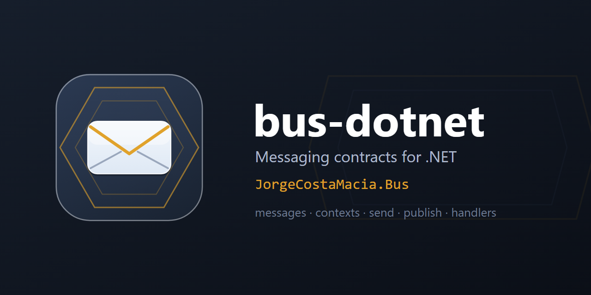

  

# bus-dotnet

> Transport-agnostic messaging contracts for .NET — messages, read-only message contexts and point-to-point / pub-sub buses — shipped as `JorgeCostaMacia.Bus`, the root every `JorgeCostaMacia.Bus.*` transport implements.

The transports live in their own repositories and release on their own: [bus-kafka-dotnet](https://github.com/JorgeCostaMacia/bus-kafka-dotnet) (Confluent.Kafka) and [bus-rabbitmq-dotnet](https://github.com/JorgeCostaMacia/bus-rabbitmq-dotnet) (RabbitMQ.Client) — a MassTransit-free bus, one package per concern. Part of the `JorgeCostaMacia.*` family, alongside [ddd-dotnet](https://github.com/JorgeCostaMacia/ddd-dotnet), [quartz-dotnet](https://github.com/JorgeCostaMacia/quartz-dotnet), [serilog-dotnet](https://github.com/JorgeCostaMacia/serilog-dotnet) and [http-dotnet](https://github.com/JorgeCostaMacia/http-dotnet). Moved out of [bus-net](https://github.com/JorgeCostaMacia/bus-net), keeping the package id.

## Requirements

The **.NET 10** SDK.

## Packages

| Package | What it does |
| --- | --- |
| [JorgeCostaMacia.Bus](https://www.nuget.org/packages/JorgeCostaMacia.Bus/) | Core message, context and bus contracts — no transport, no request/response. |

## Upgrading

What each version asks of you, when it asks anything, is in [CHANGELOG.md](CHANGELOG.md).

## Contact

- [LinkedIn](https://www.linkedin.com/in/jorge-costa-macia-842817164/)
- [GitHub](https://github.com/JorgeCostaMacia/)
- [Bitbucket](https://bitbucket.org/jorgecostamacia/)
